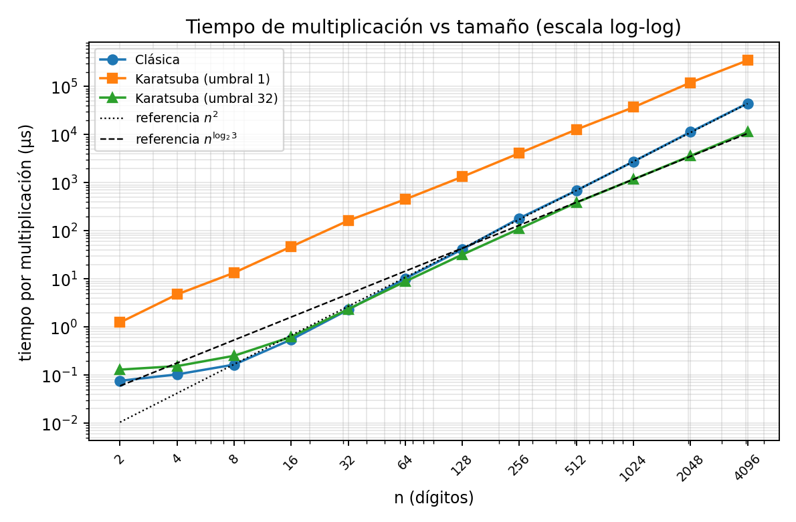
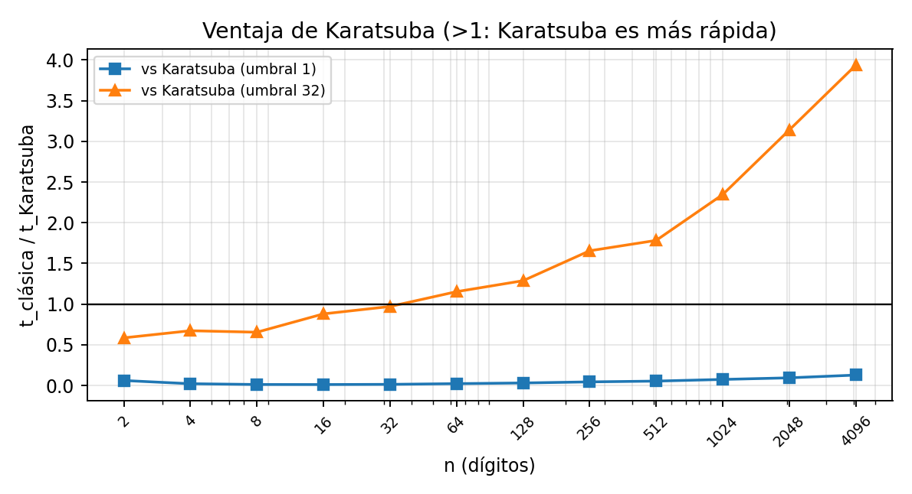

# 1. Introducción y diseño

Multiplicar dos enteros de $n$ dígitos con el método del colegio exige multiplicar cada dígito de uno por cada dígito del otro: $\Theta(n^2)$ operaciones. Karatsuba (1960) usa Divide y Vencerás con una identidad algebraica que baja el número de subproblemas de 4 a 3. Implementamos ambos algoritmos en C++17, los validamos entre sí y medimos su tiempo.

**Representación.** Un número es un `std::vector<int>` con un dígito decimal por posición, en *little-endian* (índice 0 = dígito menos significativo; $1234 \to \{4,3,2,1\}$). Se eligió así porque el acarreo de la suma y el préstamo de la resta avanzan en el sentido del índice, y porque multiplicar por $10^k$ equivale a insertar $k$ ceros al inicio del vector. No se usa `long long` ni `__int128` para el número completo (solo `int` para un dígito más un acarreo) ni ninguna biblioteca externa.

**Decisiones de diseño.**

- *Relleno a potencia de 2 una sola vez.* `rellenarPotencia2` se llama al entrar a `karatsuba`. Dentro de la recursión solo se igualan longitudes, porque $x_1+x_0$ puede tener $m+1$ dígitos y rellenarlo otra vez a potencia de 2 lo llevaría a $2m=n$ dígitos: $P_3$ tendría el tamaño del problema padre y se perdería la cota. Por eso las auxiliares (`sumar`, `restar`, `partir`, `desplazar`) aceptan longitudes variables y operandos sin normalizar.
- *Orden de la resta.* El término central se calcula como `restar(restar(P3, P1), P2)`. Así no hace falta aritmética con signo (justificación en la sección 2).
- *Caso base.* Si $n\le n_0=32$ se multiplica con la clásica; el valor se justificó midiendo (sección 4.3). Con `umbral = 1` se obtiene la versión "pura" que parte hasta un dígito.

# 2. Deducción de la identidad de Karatsuba

Sean $x,y$ de $n$ dígitos en base $B=10$ y $m=n/2$. Se parten por la mitad:
$$x = x_1 B^m + x_0,\qquad y = y_1 B^m + y_0 .$$
Multiplicando directamente,
$$xy = x_1y_1\,B^{2m} + (x_1y_0 + x_0y_1)\,B^m + x_0y_0 .$$
Esto pide **cuatro** productos de mitades y da $T(n)=4T(n/2)+\Theta(n)$, que no mejora el orden cuadrático (sección 3).

**Por qué bastan tres.** Los extremos $x_1y_1$ y $x_0y_0$ se necesitan tal cual. Del término central solo interesa la *suma* $x_1y_0+x_0y_1$, no cada sumando por separado. Si se multiplica la suma de las mitades,
$$P_3 = (x_1+x_0)(y_1+y_0) = x_1y_1 + x_1y_0 + x_0y_1 + x_0y_0 = P_1 + (x_1y_0+x_0y_1) + P_2,$$
con $P_1=x_1y_1$ y $P_2=x_0y_0$. Despejando,
$$x_1y_0 + x_0y_1 = P_3 - P_1 - P_2 \quad\Longrightarrow\quad xy = P_1B^{2m} + (P_3-P_1-P_2)\,B^m + P_2 .$$
Un solo producto nuevo ($P_3$) reemplaza a los dos productos cruzados; el resto son sumas, restas y desplazamientos, todos $\Theta(n)$.

**Orden de la resta.** Como $P_3-P_1 = P_2 + x_1y_0 + x_0y_1 \ge P_2$, tanto $P_3-P_1$ como $(P_3-P_1)-P_2$ son no negativos. Restando en ese orden, ninguna resta intermedia es negativa y `restar` solo necesita la precondición $A\ge B$.

# 3. Resolución de la recurrencia

Cada llamada hace tres productos de tamaño $n/2$ y trabajo no recursivo lineal: 2 `partir`, 2 `sumar` (para $x_1+x_0$ y $y_1+y_0$), 2 `restar`, 2 `desplazar` y 2 `sumar` de recomposición; cada una recorre los dígitos una vez con trabajo constante por posición. Entonces
$$T(n) = 3\,T(n/2) + cn,\qquad T(1)=c_0 .$$

## 3.1 Teorema Maestro

Para $T(n)=aT(n/b)+f(n)$ se compara $f(n)$ con $n^{\log_b a}$. Aquí $a=3$, $b=2$, $f(n)=\Theta(n)$, y $n^{\log_b a}=n^{\log_2 3}\approx n^{1.585}$. Como
$$f(n) = n = O\!\left(n^{\log_2 3-\varepsilon}\right)\quad\text{con }\varepsilon=\log_2 3-1\approx 0.585>0,$$
se cumple el **caso 1**: el trabajo por nodo crece polinómicamente más despacio que el número de hojas, y estas dominan. Por tanto $T(n)=\Theta(n^{\log_2 3})\approx\Theta(n^{1.585})$. Con cuatro productos, $a=4$ y $n^{\log_2 4}=n^2$ (también caso 1): dividir por sí solo no mejora el método del colegio; la ganancia viene de bajar $a$ de 4 a 3.

## 3.2 Árbol de recurrencia

| Nivel $i$ | Nodos | Tamaño por nodo | Costo por nodo | Costo del nivel |
|:--:|:--:|:--:|:--:|:--:|
| 0 | 1 | $n$ | $cn$ | $cn$ |
| 1 | 3 | $n/2$ | $cn/2$ | $\tfrac32 cn$ |
| $i$ | $3^i$ | $n/2^i$ | $cn/2^i$ | $(\tfrac32)^i cn$ |
| $h=\log_2 n$ (hojas) | $3^{\log_2 n}$ | 1 | $c_0$ | $c_0\,3^{\log_2 n}$ |

- **Altura:** el tamaño se divide entre 2 por nivel hasta llegar a 1, así que $h=\log_2 n$.
- **Hojas:** $3^{\log_2 n}=2^{\log_2 3\cdot\log_2 n}=n^{\log_2 3}$.
- **Niveles internos** (serie geométrica de razón $3/2>1$), usando $(3/2)^{\log_2 n}=n^{\log_2 3}/n$:
$$\sum_{i=0}^{h-1}cn\left(\tfrac32\right)^i = cn\,\frac{(3/2)^h-1}{1/2} = 2c\left(n^{\log_2 3}-n\right).$$
- **Total:** $T(n)=2c(n^{\log_2 3}-n)+c_0n^{\log_2 3}=(2c+c_0)\,n^{\log_2 3}-2cn=\Theta(n^{\log_2 3})$.

**Qué aporta cada método.** El Teorema Maestro entrega el veredicto comparando $f(n)$ con $n^{\log_b a}$. El árbol *muestra por qué*: el costo por nivel crece con razón $3/2$ (se triplican los nodos pero el tamaño solo se divide a la mitad), una serie creciente queda dominada por su último término, y ese último nivel tiene $n^{\log_2 3}$ hojas. Además da la constante.

## 3.3 Por qué el exponente es $\log_2 3$

El exponente es $\log_b a$: el logaritmo del número de subproblemas en la base del factor de reducción. Duplicar $n$ agrega un nivel al árbol y ese nivel triplica las hojas, luego $T(2n)/T(n)\to 3=2^{\log_2 3}$, es decir, $T(n)=\Theta(n^{\log_2 3})$. Con cuatro productos la razón sería $4=2^2$. Ahorrar un producto por nivel, repetido en los $\log_2 n$ niveles, baja el exponente de 2 a $\log_2 3\approx1.585$.

**Detalle que no cambia el orden.** $x_1+x_0$ puede tener $m+1$ dígitos, por lo que en realidad $T(n)\le 2T(n/2)+T(n/2+1)+cn$. Un sumando constante en el argumento no altera la solución $\Theta(n^{\log_2 3})$ (mismo argumento de CLRS para pisos y techos).

# 4. Análisis experimental

## 4.1 Montaje

- **Máquina y compilador:** Intel Xeon @ 2.10 GHz (1 núcleo disponible), Linux (Ubuntu 24.04), g++ 13.3.0, `-std=c++17 -O2 -Wall -Wextra`.
- **Tamaños:** $n=2,4,8,\dots,4096$ dígitos. Operandos aleatorios de exactamente $n$ dígitos (semilla fija).
- **Medición:** `std::chrono::steady_clock`. Cada celda se repite hasta acumular al menos 200 ms; el tiempo es total/repeticiones. Se hacen 5 ensayos por celda y se reporta la **mediana**.
- **Consumo del resultado:** se suman los dígitos de cada producto en un acumulador `volatile` (así el compilador no elimina el cálculo) y, para cada $n$, se verifica que clásica, Karatsuba (umbral 1) y Karatsuba (umbral 32) den el mismo producto.
- Código en `bench/benchmark.cpp`, datos en `resultados/tiempos.csv`, gráficas con `scripts/graficar.py`.

## 4.2 Resultados

| $n$ | Clásica (µs) | Karatsuba $n_0{=}1$ (µs) | Karatsuba $n_0{=}32$ (µs) | Clás./K($n_0{=}32$) |
|--:|--:|--:|--:|--:|
| 2 | 0.08 | 1.24 | 0.13 | 0.59 |
| 4 | 0.10 | 4.75 | 0.15 | 0.67 |
| 8 | 0.16 | 13.41 | 0.25 | 0.65 |
| 16 | 0.55 | 46.73 | 0.62 | 0.88 |
| 32 | 2.28 | 162.16 | 2.35 | 0.97 |
| 64 | 10.18 | 450.25 | 8.83 | 1.15 |
| 128 | 41.11 | 1323.11 | 31.93 | 1.29 |
| 256 | 181.96 | 4095.47 | 109.94 | 1.66 |
| 512 | 686.09 | 12701.10 | 384.86 | 1.78 |
| 1024 | 2748.23 | 36874.40 | 1171.33 | 2.35 |
| 2048 | 11307.50 | 120086.00 | 3602.04 | 3.14 |
| 4096 | 44485.10 | 347138.00 | 11303.40 | 3.94 |

{width=62%}

**Orden de crecimiento.** Ajustando una recta a $\log t$ contra $\log n$ para $n\ge256$ se obtienen pendientes de 1.99 para la clásica (teórico 2) y 1.61 para Karatsuba con umbral 1 (teórico 1.585). Al duplicar $n$ de 2048 a 4096, el tiempo se multiplica por 3.93 (clásica, $\approx4=2^2$) y por 2.89 y 3.14 (Karatsuba con umbral 1 y 32, $\approx3=2^{\log_2 3}$). Los datos confirman la predicción: la clásica es cuadrática y Karatsuba crece como $n^{1.585}$. La pendiente de la versión con umbral 32 en el ajuste (1.66) queda por encima de 1.585 porque el rango incluye tamaños donde todavía pesa la clásica de las hojas; sus razones al duplicar se acercan a 3 en los tamaños mayores.

## 4.3 Punto de cruce y por qué la clásica gana con números pequeños

- **Karatsuba con umbral 32** alcanza a la clásica hacia $n=32$ (razón 0.97, empate) y la supera desde **$n=64$** (1.15×); la ventaja crece a 2.3× en $n=1024$ y 3.9× en $n=4096$ (figura 2).
- **Karatsuba pura (umbral 1) no cruza en el rango medido:** sigue siendo 7.8 veces más lenta en $n=4096$. Como la razón clásica/Karatsuba crece cerca de $2^{2-1.585}\approx1.33$ por cada duplicación, extrapolando el cruce quedaría del orden de $5\cdot10^5$ dígitos (estimación, no medida).

La causa son las **constantes ocultas**. Karatsuba hace menos *multiplicaciones de dígitos*, pero en cada nodo ejecuta diez operaciones lineales y crea varios `std::vector` temporales (`partir`, `sumar`, `restar`, `desplazar`), con sus asignaciones de memoria y copias. En los nodos pequeños ese costo domina sobre las pocas multiplicaciones que se ahorran; en cambio, el doble bucle de la clásica trabaja sobre un único vector, sin asignaciones intermedias y con acceso secuencial. La cota asintótica solo habla de cómo crece el tiempo, no de las constantes; por eso la clásica puede ganar para $n$ pequeño y Karatsuba solo gana cuando $n^{2}/n^{1.585}=n^{0.415}$ compensa el sobrecosto por nodo.

**Justificación del umbral $n_0=32$.** Mediciones del rol B (`resultados/umbral.tsv`, Apple M4) compararon umbrales de 1 a 512: los tiempos mínimos se dan entre 32 y 64, con 64 a menos de 4 % de 32 (dentro del ruido); se eligió el menor del rango. Con umbrales grandes (256 o más) el tiempo sube de nuevo porque se usa la clásica $\Theta(n^2)$ donde ya no conviene. El umbral solo cambia la constante, no el orden: las hojas cuestan $\Theta\!\left(n_0^{\,2-\log_2 3}\,n^{\log_2 3}\right)$.

{width=52%}

# 5. Conclusiones y dificultades

**Conclusiones.**

1. Reducir los subproblemas de 4 a 3 cambia el exponente de $2$ a $\log_2 3$; el Teorema Maestro (caso 1) y el árbol de recurrencia coinciden, y las mediciones lo confirman (razones ≈ 4 y ≈ 3 al duplicar $n$).
2. La ventaja asintótica no se traduce automáticamente en velocidad: sin un umbral, Karatsuba pura es más lenta que la clásica en todo el rango medido. Con $n_0=32$ la versión híbrida cruza en $n\approx 64$ y es unas 3.9 veces más rápida en $n=4096$.
3. Las constantes ocultas (copias, asignaciones de `std::vector`) explican la diferencia entre la complejidad asintótica y el rendimiento real.

**Dificultades.**

- $x_1+x_0$ puede tener $m+1$ dígitos: obligó a que las auxiliares admitieran longitudes variables y a rellenar a potencia de 2 solo al inicio.
- La resta del término central debía hacerse como $(P_3-P_1)-P_2$ para evitar números negativos sin implementar signo.
- Medir bien: con tamaños pequeños los tiempos son de décimas de microsegundo, por lo que hubo que repetir hasta superar 200 ms, tomar la mediana de varios ensayos y consumir el resultado para que `-O2` no elimine el cálculo.
- Elegir el umbral del caso base exigió medirlo, no suponerlo.

**Limitaciones.** Los tiempos son de una sola máquina (compartida, un núcleo); el valor absoluto cambia entre equipos, pero la forma de las curvas y el orden de crecimiento no. El cruce de Karatsuba pura es una extrapolación.

# 6. Declaración de uso de IA

El grupo usó Claude (Anthropic) y ChatGPT (OpenAI) como herramientas de apoyo: para entender el enunciado y organizar el trabajo, implementar, revisar y depurar el código, escribir las pruebas y el benchmark, ejecutar y analizar las mediciones, y redactar y revisar este informe y la wiki. Los resultados provienen de ejecutar el código; cada integrante revisó lo que produjo la IA y puede explicarlo. El registro detallado de cada integrante está en la wiki del repositorio, en la página *Uso de Inteligencia Artificial*.

En la parte experimental, Juan Esteban Peña usó Claude para escribir el borrador de `bench/benchmark.cpp` y `scripts/graficar.py`, ejecutar las mediciones, redactar el borrador de este informe y darle al texto final un registro más formal.
